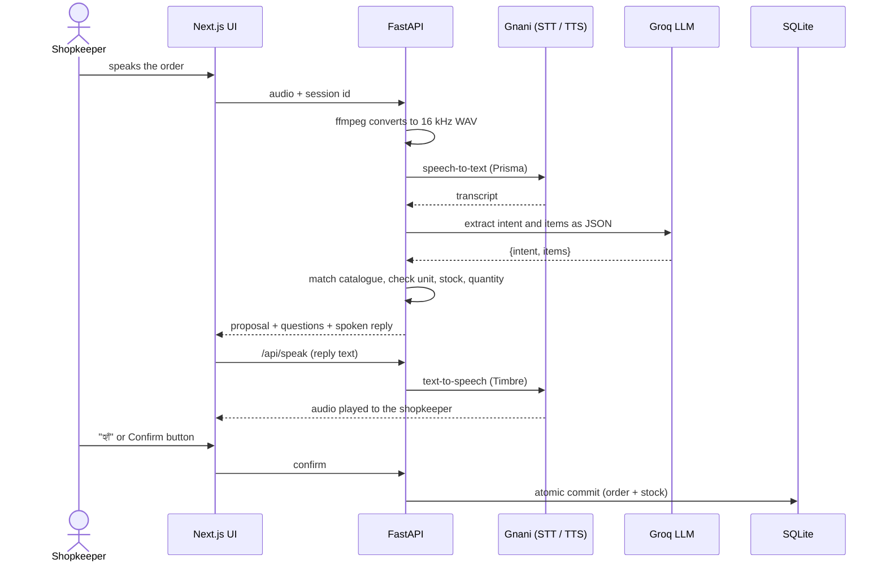
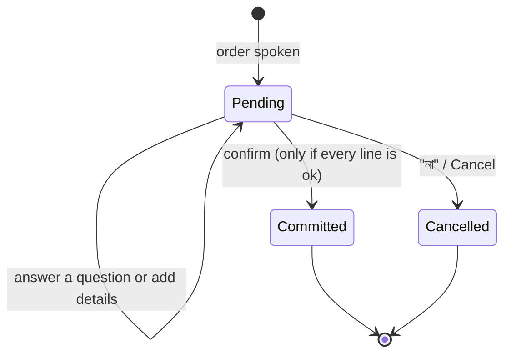

<div align="center">

# 🛒 KiranaVoice AI

### A Bengali-first voice assistant that takes orders for neighbourhood kirana stores

*Say the order. Get a question if it's unclear. Nothing is saved until you confirm.*


<!-- Add a screenshot or GIF here:   -->

</div>

> **Built for the [Great Indian AI Internship Challenge](https://www.gnani.ai/internship) by Gnani.ai.**
> This is an independent project. It is not an official Gnani product.

---

## 📖 Table of contents

- [The problem](#-the-problem)
- [What it does](#-what-it-does)
- [How it works](#-how-it-works)
- [Safety by design](#-safety-by-design)
- [Evaluation](#-evaluation)
- [Tech stack](#-tech-stack)
- [Getting started](#-getting-started)
- [API reference](#-api-reference)
- [Project structure](#-project-structure)
- [Known limitations](#-known-limitations)
- [Roadmap](#-roadmap)

---

## 🎯 The problem

Small neighbourhood grocery stores run on spoken orders. A customer says what they want, in Bengali mixed with English, while the shopkeeper is already serving someone else. Orders end up in a notebook, stock is guessed, and mistakes are only found later.

Most voice demos stop at *"here is the transcript"*. A real shop needs more: the right product, the right unit, enough stock, and a way to ask **"which oil, mustard or sunflower?"** instead of guessing.

## ✨ What it does

A shopkeeper speaks naturally, in **Bengali, Benglish, Hindi or Hinglish**. The app understands the order, checks it against the catalogue and stock, asks about anything unclear, reads the order back aloud, and **saves it only after the shopkeeper says yes**.

A real run from this project:

| Who | What |
|---|---|
| 🧑 Shopkeeper | *আমার দুই কেজি আটা আর পাঁচ কেজি তেল* |
| 🤖 App | তেল: কোনটা? সরষের তেল না সানফ্লাওয়ার তেল? |
| 🧑 Shopkeeper | *সরষের তেল* |
| 🤖 App | সরষের তেল লিটার হিসেবে বিক্রি হয়। কতটা লাগবে? |
| 🧑 Shopkeeper | *পাঁচ লিটার* |
| 🤖 App | দুই কেজি আটা আর পাঁচ লিটার সরষের তেল. মোট 915 টাকা। নিশ্চিত করব? |
| 🧑 Shopkeeper | *হ্যাঁ* |
| 🤖 App | অর্ডার হয়ে গেছে। মোট 915 টাকা। |

The app caught two things a naive system would miss: the oil was ambiguous, and "5 kg" is the wrong unit for oil.

### Feature highlights

| | Feature |
|---|---|
| 🎙️ | **Voice in the browser**, with live level bars and a one-tap mic |
| 🗣️ | **Code-mixed speech**: Bengali script, Benglish, Hinglish and Devanagari |
| 🧠 | **Structured extraction**: the LLM turns speech into `{intent, items[{phrase, qty, unit}]}` |
| 🔍 | **Catalogue matching** with Bengali, Benglish and Hindi aliases plus fuzzy spelling tolerance |
| ❓ | **Clarification questions** for ambiguous, unknown, wrongly-united, missing or implausible quantities |
| ✅ | **Confirmation gate**: say "হ্যাঁ" or press the button. Not before |
| 🗄️ | **Atomic orders**: one SQLite transaction saves the order and reduces stock, or changes nothing |
| 🔁 | **Idempotent confirm**: a double tap can't save an order twice |
| 🔊 | **Spoken replies** in Bengali through Gnani text-to-speech |
| 📊 | **Evaluation harness** comparing the real pipeline against a naive baseline |
| 📒 | **Ledger-style UI**: ruled paper, red margin, and a violet "নিশ্চিত" stamp on a confirmed order |

---

## 🏗️ How it works



### The conversation state machine



### What the validator checks

Every line of a proposed order gets one status. **Only an order where every line is `ok` can be confirmed.**

| Status | Meaning | The app asks |
|---|---|---|
| `ok` | Product, unit, quantity and stock are all fine | (nothing) |
| `ambiguous` | "তেল" could be mustard or sunflower | "কোনটা?" |
| `unknown` | Product not in the catalogue | "অন্য নামে বলবেন?" |
| `bad_qty` | Missing, zero or negative quantity | "কতটা লাগবে?" |
| `unit_mismatch` | e.g. litres of atta | "… কেজি হিসেবে বিক্রি হয়" |
| `implausible_qty` | e.g. 0.0025 kg of salt, or half a soap | "খুব কম। কতটা লাগবে?" |
| `out_of_stock` | More than the live stock | "মাত্র … আছে" |

<details>
<summary><b>Example API response</b> (<code>POST /api/interpret</code>, trimmed)</summary>

```json
{
  "transcript": "আমার দুই কেজি আটা আর পাঁচ কেজি তেল",
  "intent": "order",
  "lines": [
    { "name": "আটা", "product_id": "atta", "qty": 2.0, "unit": "kg", "amount": 90.0, "status": "ok" },
    { "name": "তেল", "product_id": null, "qty": 5.0, "unit": "kg", "amount": null,
      "status": "ambiguous", "options": ["mustard_oil", "sunflower_oil"] }
  ],
  "total": 90.0,
  "questions": ["তেল: কোনটা? সরষের তেল না সানফ্লাওয়ার তেল?"],
  "can_confirm": false,
  "status": "pending",
  "proposal_id": "d046965da0bf4defb1eb9dec37ad5513"
}
```
</details>

---

## 🛡️ Safety by design

The model **proposes**. Deterministic code **decides**.

1. **The LLM never writes to the database.** It only returns JSON. Prices, stock, units and totals come from Python and SQLite.
2. **No order is saved without confirmation**, and not while any question is open. Saying "হ্যাঁ" with an unresolved line saves nothing.
3. **Live re-check at commit time.** Stock and price are read from the database inside the transaction, not trusted from the earlier proposal.
4. **All-or-nothing writes.** If any line fails, the whole order rolls back.
5. **Idempotency.** A `proposal_id` is unique in the database, so a repeated confirm returns the original order.
6. **Plausibility guard.** Quantities that are almost certainly speech or model slips (for example "250 g" misread as 2.5 g) are questioned, not saved.
7. **Short aliases match exactly only.** "cha" can't fuzzy-match inside "chawal" and silently turn rice into tea.

---

## 📊 Evaluation

The project ships with an evaluation harness. The point is to measure whether the system completes the **task**, not only whether the transcript looks right.

**Method**

- **61 synthetic test cases**, many of them multi-turn: Bengali script (17), Benglish (9), Hinglish and Devanagari (7), code-mixed (3), ambiguity resolved over several turns (6), must-stop-and-ask negatives (13), cancels (3), and noise or non-orders (3).
- **Two pipelines on identical LLM output:**
  - **Improved**: the real pipeline (matching, validation, clarification, confirmation, atomic commit).
  - **Baseline**: a deliberately naive version that takes the first catalogue match and saves immediately, with no questions, no unit or stock checks and no confirmation.
- **Metrics:** order exact-match accuracy, task completion, correct clarification rate, **unsafe commits** (anything saved when nothing should be), and latency per turn.

**Results on the development set** (61 cases, Nov 3 run, text level)

| Metric | Improved | Baseline |
|---|---|---|
| Order exact-match accuracy | **100%** (42/42) | 76.2% (32/42) |
| Task completion | 100% (42/42) | 100% (42/42) |
| Correct clarification | **100%** (13/13) | 0% (0/13) |
| Unsafe commits (target 0) | **0 of 19** | 15 of 19 |
| Overall pass | **100%** (61/61) | 57.4% (35/61) |
| LLM + rules latency per turn | p50 0.88 s, p95 1.36 s | |

Before the last round of fixes the same set scored 98.3% (58/59). The one miss was a wrong order: "আড়াইশো গ্রাম নুন" (250 g of salt) was saved as 0.0025 kg. That led to the plausibility guard and the hundreds rule in the prompt.

> ⚠️ **Read these numbers carefully.**
> - This is a **development set**. The prompt and rules were adjusted after failures on these same cases, so 100% here is expected and does **not** mean 100% on new speech. A separate held-out set is planned and will be reported on its own.
> - The evaluation is **text level**: it starts from the transcript. Speech recognition errors, noise and word error rate are measured separately (see the roadmap).
> - The baseline is intentionally simple. It shows what the safety layers add, not what a good alternative would score.
> - Results were produced with `openai/gpt-oss-20b` on Groq. Other models may differ.

Full per-case results are in [`backend/evaluation/results.json`](backend/evaluation/results.json).

<details>
<summary><b>What the evaluation found (and fixed)</b></summary>

| Finding | Fix |
|---|---|
| "এক ডজন ডিম" rejected as out of stock (LLM converted a dozen to 12, then the code multiplied again) | LLM must report the number as spoken; conversion happens only in code |
| "একটা সাবান" returned no quantity | Prompt: a count word always means 1, with examples |
| "chawal" resolved to tea (short alias fuzzy-matched inside a longer word) | Aliases under 4 characters match exactly only |
| LLM transliterated "chawal" into Bengali script | Prompt: copy product words character for character |
| "এক লিটার তেল" treated as a bare quantity | Prompt: empty product only when no product word is spoken |
| "আড়াইশো গ্রাম" read as 2.5 g and saved as 0.0025 kg | Plausibility guard in the validator, plus hundreds in the prompt |
</details>

---

## 🧰 Tech stack

| Layer | Technology |
|---|---|
| Speech-to-text | **Gnani Prisma** (`prisma-v2.5`) |
| Text-to-speech | **Gnani Timbre** (`timbre-v3.0`, voice "Shivani", Bengali) |
| LLM extraction | **Groq**, default model `openai/gpt-oss-20b` |
| Backend | Python, FastAPI, Pydantic, httpx |
| Matching | Alias index plus `rapidfuzz` |
| Audio | `ffmpeg` (browser audio to 16 kHz mono WAV) |
| Database | SQLite (orders, order items, products, events) |
| Frontend | Next.js, TypeScript, Tailwind CSS |
| Fonts | Tiro Bangla (handwriting) and Hind Siliguri (UI) |
| Testing | `pytest` |

---

## 🚀 Getting started

### Prerequisites

- Python 3.13 and Node.js
- `ffmpeg` on your PATH (`winget install Gyan.FFmpeg` on Windows, `brew install ffmpeg` on macOS, `apt install ffmpeg` on Ubuntu)
- A **Gnani API key** from [app.gnani.ai/voice](https://app.gnani.ai/voice) (API Keys, with Speech to Text and Text to Speech scopes)
- A **Groq API key** from [console.groq.com](https://console.groq.com)

### 1. Backend

```powershell
git clone <repo-url>
cd kiranavoice\backend
python -m venv .venv
.venv\Scripts\activate          # macOS/Linux: source .venv/bin/activate
pip install -r requirements.txt
```

Create `backend/.env` (it is git-ignored):

```env
GNANI_API_KEY=your_gnani_key
GROQ_API_KEY=your_groq_key

# optional
GROQ_MODEL=openai/gpt-oss-20b
KIRANA_DEV=1        # enables POST /api/dev/reset for testing. Never set in production.
```

Run it:

```powershell
uvicorn app.main:app --reload
```

The API is at `http://localhost:8000` and its docs at `http://localhost:8000/docs`. The SQLite database `kirana.db` is created on first start and seeded from the sample catalogue.

### 2. Frontend

```powershell
cd ..\frontend
npm install
```

Create `frontend/.env.local`:

```env
NEXT_PUBLIC_API_URL=http://localhost:8000
```

```powershell
npm run dev
```

Open `http://localhost:3000`, allow the microphone, press the yellow button, and say an order. Add `?demo` to the URL to preview the ledger with a sample order, or `?demo=confirmed` to see the stamp.

### 3. Try it without a microphone

```powershell
curl.exe -F "text=আমার দুই কেজি আটা আর পাঁচ কেজি তেল" -F "session_id=t1" http://localhost:8000/api/interpret
curl.exe -F "text=সরষের তেল"  -F "session_id=t1" http://localhost:8000/api/interpret
curl.exe -F "text=পাঁচ লিটার" -F "session_id=t1" http://localhost:8000/api/interpret
curl.exe -F "text=হ্যাঁ"        -F "session_id=t1" http://localhost:8000/api/interpret
curl.exe http://localhost:8000/api/orders
```

### 4. Tests and evaluation

```powershell
cd backend
python -m pytest -q                          # unit and flow tests (no API calls)

python -m evaluation.make_cases              # regenerate evaluation/cases.jsonl
python -m evaluation.run_eval --mode both    # needs GROQ_API_KEY
python -m evaluation.show_case c28           # inspect what the LLM extracted for a case
```

The evaluation caches LLM answers in `evaluation/.llm_cache.json` (git-ignored). The first run takes around 10 minutes on Groq's free tier because of its tokens-per-minute limit. Re-runs that don't change the prompt are free.

---

## 🔌 API reference

| Method | Endpoint | Purpose |
|---|---|---|
| `POST` | `/api/voice-order` | Audio in, one conversation turn out (transcript, proposal, spoken reply, per-stage timings) |
| `POST` | `/api/interpret` | Same as above, from text. For testing |
| `POST` | `/api/confirm` | Confirm a pending proposal (`session_id`, `proposal_id`). Idempotent |
| `POST` | `/api/cancel` | Discard the pending order |
| `POST` | `/api/speak` | Text to Bengali speech (WAV) |
| `POST` | `/api/transcribe` | Raw speech-to-text |
| `GET` | `/api/orders` | Saved orders with line items |
| `GET` | `/api/products` | Catalogue with live stock and prices |
| `POST` | `/api/dev/reset` | Clears orders and restores stock. Only when `KIRANA_DEV=1` |

---

## 📁 Project structure

```
kiranavoice/
├── backend/
│   ├── app/
│   │   ├── main.py          # FastAPI endpoints
│   │   ├── gnani.py         # Gnani STT / TTS client
│   │   ├── audio.py         # ffmpeg conversion to 16 kHz WAV
│   │   ├── extract.py       # Groq extraction: prompt, JSON parsing, retries
│   │   ├── catalog.py       # sample catalogue and aliases
│   │   ├── matcher.py       # alias and fuzzy product matching
│   │   ├── rules.py         # deterministic validation of every line
│   │   ├── flow.py          # conversation state machine (propose, clarify, confirm)
│   │   ├── db.py            # SQLite schema and atomic commit
│   │   └── speech_text.py   # Bengali sentences read aloud
│   ├── evaluation/          # cases, runner, baseline, results.json
│   ├── tests/
│   └── requirements.txt
└── frontend/
    ├── app/                 # layout, page, global styles
    └── components/
        └── LedgerOrder.tsx  # the ruled-ledger order view and stamp
```

---

## ⚠️ Known limitations

Honest notes, so nobody is surprised:

- **Speech recognition is not perfect.** In early tests the first word of a recording was sometimes dropped, which was traced to the browser's microphone, not the API. A full audio-level accuracy test has not been completed yet.
- **Rate limits.** On Groq's free tier, this prompt allows roughly 8 order requests per minute. A busy public demo would hit that. Requests are retried briefly and then fail with an error message.
- **Sample catalogue.** 15 demo products with illustrative prices and stock. There is no catalogue editor.
- **Single store, no login.** Sessions are held in memory and are lost when the server restarts.
- **Spoken numbers.** Quantities up to 20 and common halves are spoken as Bengali words. Larger numbers, such as totals, are spoken as digits, and how Gnani's voice reads them has not been fully tested.
- **Debug audio.** `/api/voice-order` writes `last.wav` locally for debugging. It is git-ignored and must be removed before any deployment.
- **Data.** All test data is synthetic. No real customer recordings are used.

## 🗺️ Roadmap

- [x] Browser voice capture, Gnani speech-to-text and text-to-speech
- [x] LLM extraction with validation, clarification and confirmation
- [x] Atomic SQLite orders and live stock
- [x] Evaluation harness with baseline comparison
- [ ] Audio-level evaluation (recorded and noisy speech, word error rate, end-to-end accuracy)
- [ ] Held-out test set reported separately from the development set
- [ ] Evaluation dashboard tab in the UI
- [ ] Orders and stock tabs in the UI
- [ ] Shorter prompt and response caching to ease rate limits
- [ ] Public deployment

---

<div align="center">

**Built by Shrey Kumar** for the Great Indian AI Internship Challenge

*Powered by Gnani.ai speech models*

</div>
